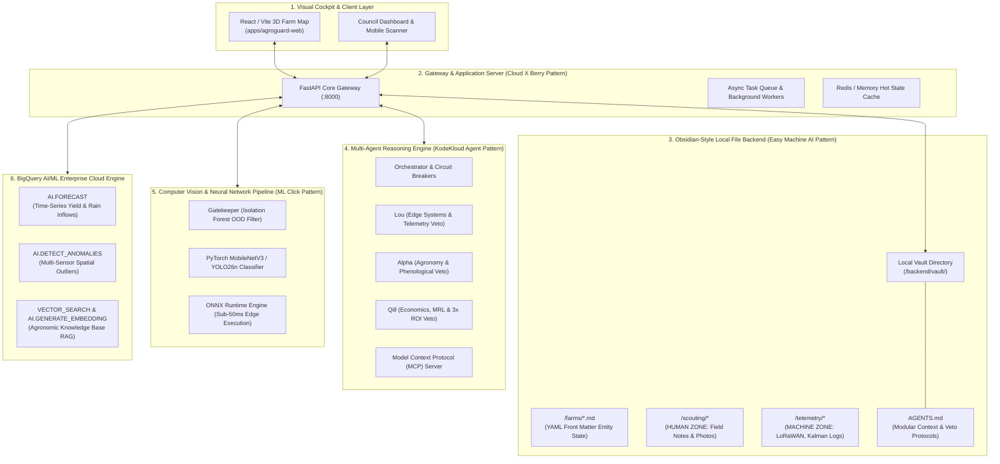
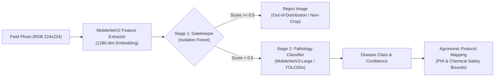

# `agentsupport.md` — AgroGuard & AgriQill Autonomous Backend Specification

> **Execution Directive for Claude & Autonomous Engineering Agents**  
> This specification defines the complete architecture for building the **Obsidian-Style Autonomous AI Backend, Neural Network Training Pipeline, and BigQuery AI/ML Integration** for **AgroGuard** and the **Farm Map (AgriQill)**.  
> Read this document in full before generating, refactoring, or running any code.

---

## 1. Executive System Topology

AgroGuard unites **edge cyber-physical field hardware**, a **local-first Markdown & SQLite database**, an **orchestrated 3-Agent Executive Council**, and **BigQuery AI/ML cloud analytics** into a single deterministic Decision Support System (DSS):



---

## 2. Pillar 1: Obsidian-Style Local-First Backend (`4z2i6UsQG1k`)

### 2.1 File-Based Database Architecture
The backend treats plain text `.md` files as an ACID-compliant local document database:
- **Files = Entities / Rows**: Every farm holding (`FM-001.md`), individual paddy (`PD-01.md`), and buyer contract (`BUYER-EXP-01.md`) is stored as a standalone Markdown file.
- **YAML Front Matter = Columns / Properties**: All structured data is stored in the header, enabling zero-latency reads, search indexing, and automated script manipulation.
- **Body = Append-Only Human/Machine Audit Log**: Telemetry events, scouting notes, and council verdicts are appended chronologically.

### 2.2 Human vs. Machine Zone Partitioning
To avoid catastrophic overwrites, the file vault enforces strict directory permissions:

```text
backend/vault/
├── AGENTS.md                      <-- Root Agent System Directives
├── daily/                         <-- Daily operational task roll-ups
│   └── YYYY-MM-DD.md
├── farms/                         <-- Farm profiles and holding properties
│   └── FM-001-maubin.md
├── human/                         <-- HUMAN ZONE (Read-only to background scripts)
│   ├── scouting_notes/            <-- Hand-entered visual crop symptoms
│   └── verification_checks/       <-- Signed farmer 2-minute physical checks
├── machine/                       <-- MACHINE ZONE (Automated agent execution)
│   ├── telemetry_raw/             <-- Raw ESP32/LoRaWAN packets
│   ├── kalman_water_bands/        <-- 1D Kalman filter state bands (p10, p50, p90)
│   └── model_evals/               <-- Model metrics and training logs
├── contracts/                     <-- Buyer off-take agreements & MRL limits
│   └── BUYER-EXP-01.md
└── audit/                         <-- SHA-256 tamper-proof ledger chains
    └── ledger.jsonl
```

### 2.3 Farm Entity Schema Template (`farms/FM-001.md`)

```yaml
---
farm_id: "FM-001"
name: "Maubin Delta Cooperative"
region: "Ayeyarwady"
country: "Myanmar"
coordinates: [16.7321, 95.6542]
total_area_ha: 6.20
paddies:
  - id: "PD-01"
    area_ha: 0.78
    crop_variety: "Pawsan_Baygyar"
    transplanted_at: "2026-08-15"
    soil_type: "vertisol_clay"
    awd_trigger_depth_cm: -15.0
    bund_height_cm: 25.0
active_sensor_nodes: 4
sensor_confidence_score: 0.92
soil_properties:
  clay_pct: 54.2
  sand_pct: 12.1
  ph_h2o: 6.8
  soc_g_kg: 18.5
  cec_cmolc_kg: 28.4
financial_state:
  remaining_working_budget_usd_ha: 50.00
  expected_yield_ton_ha: 4.2
  spot_price_usd_ton: 480.00
  target_contract_id: "BUYER-EXP-01"
current_alerts:
  active_vetoes: []
  triage_level: "OK"
---

# Farm FM-001 — Operational History & Telemetry Log

## Daily Council Synthesis (2026-10-23 05:00 MMT)
- **1D Kalman Depth**: -8.4 cm (Safe AWD threshold, no irrigation needed).
- **Vapor Pressure Deficit (VPD)**: 0.45 kPa (Mild humidity; blast risk monitored).
- **Scheduled Fleet Action**: Agras Drone Scout flight at 07:30 MMT (Coverage: 7.5 ha/h).
```

---

## 3. Pillar 2: AI Agent Council & MCP Tool Protocols (`ZaPbP9DwBOE`)

### 3.1 Council Architecture & Deterministic Pre-Math
The multi-agent council consists of three competing specialists governed by deterministic invariant pre-computation ([`deterministic_engine.py`](file:///C:/Users/ASUS/Downloads/AgroGuard_Quil/AgroGuard-Unified/backend/agroguard/app/services/council/deterministic_engine.py)):
- **Lou**: Edge AI, LoRaWAN, sub-canopy sensors, and physical hardware telemetry validation.
- **Alpha**: Generational agronomy, root-zone biology, crop phenology, and zero-cash cultural practices.
- **Qill**: Agri-business, working capital liquidity, MRL export standards, and single-season 3x ROI ceilings.

### 3.2 Non-Negotiable Veto Adjudication Laws
1. **Lou's Telemetry Integrity Gate (`HARDWARE_DRIFT_VETO`)**:
   - If an anomaly is isolated to 1 node while adjacent nodes are stable, OR if rate-of-change exceeds soil mechanics bounds (e.g. moisture drops $>15\%/\text{hr}$ in heavy clay due to montmorillonite cracking), Lou suppresses all input spending and outputs a 2-minute physical inspection cue.
2. **Alpha's Biological Gate (`BIOLOGICAL_VETO`)**:
   - Holds absolute veto over chemical applications during peak **Flowering** (pollinator toxicity), flood irrigation during saturated anaerobic conditions, or labor workflows exceeding daily capacity.
3. **Qill's Solvency Gate (`ECONOMIC_VETO`)**:
   - Holds absolute veto over any intervention exceeding the remaining budget per hectare OR exceeding the **3x ROI Ceiling**:
     $$\text{Max Viable Spend} = \min\left(\text{Budget}, \, \frac{\text{At-Risk Revenue}}{3.0}\right)$$

### 3.3 Root `AGENTS.md` File Specification

```markdown
# AGENTS.md — AgroGuard Autonomous Operations Protocol

You are the operational agent engine for AgroGuard & AgriQill.
Your mission is zero-hallucination, constraint-driven agricultural decision support.

## Adjudication Principles
1. NEVER do arithmetic in LLM prompts. Always read pre-calculated metrics from DeterministicStateFacts.
2. Respect Human Boundaries: Never alter files in `/vault/human/` without an explicit user authorization token.
3. Strict Catalog Grounding: Never prescribe chemicals or SKUs outside `VERIFIED_AGRONOMY_CATALOG`.
4. Enforce Asymmetric Vetoes: If Lou, Alpha, or Qill triggers a veto, immediately halt chemical and financial recommendations and fallback to zero-cash cultural mitigation.
```

---

## 4. Pillar 3: Backend Systems Ecosystem (`mZ27vUoOEB0`)

### 4.1 Engineering Architecture
- **API Gateway (FastAPI)**: Serves async endpoints at `/api/v1/council`, `/api/v1/agriquill`, and `/api/v1/farms`.
- **In-Memory Cache (Redis / TTL Cache)**: Stores high-frequency sensor readings, Sentinel COG tile headers, and weather forecast tokens.
- **Event Bus / Task Queue**: Asynchronous background jobs run nightly at 05:00 AM to fetch weather, compute FAO-56 Penman-Monteith $ET_0$, and execute Kalman state updates.
- **Cryptographic Audit Ledger**: Every recommendation, sensor anomaly, and human sign-off appends a SHA-256 chained entry into `backend/vault/audit/ledger.jsonl`.

---

## 5. Pillar 4: Deep Learning & Neural Network Support (`42IVf4m-5fk`)

### 5.1 Hierarchical Computer Vision Architecture
The model pipeline processes visual leaf symptoms through a 2-stage neural architecture:



### 5.2 Training Script Blueprint (`scripts/train_pathology_model.py`)

```python
"""PyTorch Production Training Pipeline for Crop Pathology Classification."""
import torch
import torch.nn as nn
from torchvision import models, transforms
from torch.utils.data import DataLoader

def train_crop_model(data_dir: str, num_classes: int, epochs: int = 25):
    device = torch.device("cuda" if torch.cuda.is_available() else "cpu")
    
    # 1. ImageNet-Standard Preprocessing & Augmentation
    train_transform = transforms.Compose([
        transforms.RandomResizedCrop(224),
        transforms.RandomHorizontalFlip(),
        transforms.RandomRotation(15),
        transforms.ColorJitter(brightness=0.2, contrast=0.2),
        transforms.ToTensor(),
        transforms.Normalize([0.485, 0.456, 0.406], [0.229, 0.224, 0.225])
    ])
    
    # 2. Backbone: MobileNetV3-Large with Custom Classification Head
    model = models.mobilenet_v3_large(weights=models.MobileNet_V3_Large_Weights.DEFAULT)
    in_features = model.classifier[3].in_features
    model.classifier[3] = nn.Sequential(
        nn.Dropout(p=0.2),
        nn.Linear(in_features, num_classes)
    )
    model.to(device)
    
    # 3. Label Smoothing Cross-Entropy & Cosine Annealing Optimizer
    criterion = nn.CrossEntropyLoss(label_smoothing=0.1)
    optimizer = torch.optim.AdamW(model.parameters(), lr=1e-3, weight_decay=1e-2)
    scheduler = torch.optim.lr_scheduler.CosineAnnealingLR(optimizer, T_max=epochs)
    
    # 4. Training Loop
    model.train()
    for epoch in range(epochs):
        # Forward pass, loss computation, backpropagation, and scheduler step
        pass

    # 5. Export to ONNX for Sub-50ms CPU Edge Gateway Execution
    dummy_input = torch.randn(1, 3, 224, 224, device=device)
    torch.onnx.export(
        model, dummy_input, "trained_models/model.onnx",
        input_names=["input"], output_names=["output"],
        dynamic_axes={"input": {0: "batch_size"}, "output": {0: "batch_size"}}
    )
```

---

## 6. Pillar 5: BigQuery AI/ML Cloud Integration (`bigquery-ai-ml`)

When running macro-scale analytics across hundreds of cooperatives, AgroGuard uses **BigQuery ML** SQL functions for serverless, enterprise AI.

### 6.1 Regional Inflow & Rainfall Forecasting (`AI.FORECAST`)
Predicts rainfall and evapotranspiration trajectories per township:

```sql
SELECT *
FROM ML.FORECAST(
  MODEL `agroguard_analytics.rainfall_forecast_model`,
  STRUCT(
    7 AS horizon,
    0.90 AS confidence_level
  )
)
WHERE township = 'Maubin'
ORDER BY forecast_timestamp ASC;
```

### 6.2 Multi-Sensor Spatial Anomaly Detection (`AI.DETECT_ANOMALIES`)
Screens thousands of IoT nodes to detect region-wide sensor drift or soil cracking:

```sql
SELECT
  node_id,
  observation_timestamp,
  soil_moisture_vwc,
  is_anomaly,
  anomaly_probability
FROM ML.DETECT_ANOMALIES(
  MODEL `agroguard_analytics.moisture_anomaly_model`,
  STRUCT(0.02 AS contamination),
  (
    SELECT node_id, observation_timestamp, soil_moisture_vwc
    FROM `agroguard_analytics.field_telemetry_stream`
    WHERE observation_timestamp >= TIMESTAMP_SUB(CURRENT_TIMESTAMP(), INTERVAL 24 HOUR)
  )
);
```

### 6.3 Semantic Agronomy Vector Search (`VECTOR_SEARCH`)
Retrieves research-grounded pest treatment protocols:

```sql
SELECT
  base.doc_id,
  base.protocol_title,
  distance
FROM VECTOR_SEARCH(
  TABLE `agroguard_analytics.agronomy_knowledge_embeddings`,
  'embedding_vector',
  (
    SELECT text_embedding
    FROM ML.GENERATE_EMBEDDING(
      MODEL `agroguard_analytics.text_embedding_model`,
      (SELECT 'Magnaporthe oryzae blast treatment under high VPD' AS content)
    )
  ),
  top_k => 3,
  distance_type => 'COSINE'
);
```

---

## 7. Phased Implementation Roadmap for Claude

| Phase | Milestone | Primary Deliverable |
| :--- | :--- | :--- |
| **Phase 1** | **Vault Foundation & File Schemas** | Create `backend/vault/` directory with `farms/`, `daily/`, `scouting/`, and `telemetry/`. Establish `AGENTS.md` and Pydantic YAML parsers. |
| **Phase 2** | **Dawn Data Sync & Pipeline Script** | Build `scripts/dawn_sync.py` to fetch Open-Meteo & NASA POWER data, run FAO-56 Penman-Monteith $ET_0$, and auto-update farm front matter. |
| **Phase 3** | **Council Veto & Circuit Breaker Bridge** | Connect `subagents_council.py` to write deliberation logs into `/vault/council/` and enforce Invariants A, B, and C. |
| **Phase 4** | **Farm Map Integration** | Wire the React Farm Map (`agroguard-web`) to read/write farm states directly to the local vault via FastAPI endpoints. |
| **Phase 5** | **Neural Net & BigQuery Connectors** | Implement PyTorch ONNX edge export and configure BigQuery AI/ML query templates for cooperative analytics. |
| **Phase 6** | **Regional Market Scraper & Anti-Hallucination** | Built `app/services/regional_market.py` with IQR/Z-score fences, Myanmar unit conversions, Shan & Ayeyarwady centers, and 30 passing unit tests. |

---

## 8. Pillar 7: Regional Market Scraping & Anti-Hallucination Service (`regional_market.py`)

Implemented and verified in [`AgroGuard-Unified/backend/agroguard/app/services/regional_market.py`](file:///c:/Users/ASUS/Downloads/AgroGuard_Quil/AgroGuard-Unified/backend/agroguard/app/services/regional_market.py):

### 8.1 Invariants & Defense in Depth
1. **Provenance Tagging**: Every quote carries `MEASURED` (real bulletin or market feed), `HISTORICAL_INDEX` (verified statistical dataset), or `UNQUOTED` (explicit null with reason code `stale_feed` / `unquoted_market`).
2. **Statistical Outlier Rejection**: Double-fence quarantine:
   - Tukey Interquartile Range (IQR) fence with adaptive zero-variance floor:
     $$\text{IQR}_{\text{eff}} = \max\left(\text{IQR}, \, 0.05 \times \text{Median}\right), \quad [\text{Q}_1 - 2.5\times\text{IQR}_{\text{eff}}, \, \text{Q}_3 + 2.5\times\text{IQR}_{\text{eff}}]$$
   - Z-Score filter against regional rolling history ($|Z| > 3.0$).
3. **Myanmar Traditional Unit Normalization**:
   - `1 viss (peiktha) = 1.63293 kg`
   - Specific basket weights: Paddy (20.87 kg), Maize/Sesame (24.49 kg), Groundnut (11.34 kg), Wheat/Mustard (32.66 kg).
   - Commercial standard bags: 50 kg.
   - Dual-numeral parser supporting both ASCII (`0-9`) and Burmese numerals (`၀-၉`).
4. **Verified Centers**:
   - **Shan State**: Taunggyi, Muse, Aungban, Lashio.
   - **Ayeyarwady Delta**: Maubin, Hinthada, Pathein, Mawlamyine.
5. **Agent Qill Solvency Integration**: Automatically evaluates economic viability ($3\times$ ROI) while allowing zero-cost cultural mitigation ($0) when markets are unquoted.

---

## 9. Pillar 8: Multi-Source Scrapers & CleanMarketIntelligence Ingestion

Implemented across `regional_market.py`, `market_demand.py`, and `app/api/v1/endpoints/market.py`:

### 9.1 Multi-Source Connectors
- **Web & Association Portals (`WebPortalConnector`)**: Scrapes official bulletins from Bayintnaung Wholesale Center, Myanmar Pulses & Beans Association (MPBMA), and DOA.
- **Social & Community Feeds (`SocialCommunityConnector`)**: Ingests raw post texts from Facebook Yangon wholesale groups and regional Telegram broadcasts. Parses Burmese text and numerals (e.g. `မတ်ပဲ ၁ ပိဿာ ၅၄၀၀ ကျပ်`), currency tokens (`ကျပ်`, `ks`, `mmk`), and extracts normalized commodity prices.
- **Business Software / ERP Connector (`BusinessSoftwareConnector`)**: Adapters for agricultural cooperative CSV/JSON receipts, trade invoices, and Odoo/ERPNext webhooks.
- **Provenance Tags**: Explicit attribution (`MEASURED_PORTAL`, `MEASURED_COMMUNITY_POST`, `MEASURED_ERP`, `HISTORICAL_INDEX`, `UNQUOTED`). Zero fabricated numbers.
- **Obsidian Markdown Vault Export**: Clean intelligence is exported to `/vault/market_intelligence/` as frontmatter-rich `.md` files for Claude and human inspection.

### 9.2 Market Demand & Cobweb Price Elasticity Model (`market_demand.py`)
- **Empirical Grounding**: Backed by `Agricultural Crop-production Data of Shan State.csv` and `township_agricultural_data.csv`.
- **Cobweb Theorem Shock Modeling**: Dynamically calculates price elasticity $\varepsilon = \frac{\Delta Q / Q}{\Delta P / P}$, forecasting harvest price collapse when regional expansion exceeds absorption capacity.
- **Downside Price Collapse Scenarios**: Models Base Case, Expansion Shock (-15% to -35%), and Severe Glut Collapse (-40% to -65%).

---

## 10. Pillar 9: Farm Map 85% Natural Match & Ecological Polyculture Blueprint

Implemented in `apps/agroguard-web`:
- Component: [`EcologicalPolycultureCard.tsx`](file:///c:/Users/ASUS/Downloads/AgroGuard_Quil/AgroGuard-Unified/apps/agroguard-web/src/features/farm-simulation/components/farmmap/EcologicalPolycultureCard.tsx)
- Feasibility Calculator: [`ecologicalPolyculture.ts`](file:///c:/Users/ASUS/Downloads/AgroGuard_Quil/AgroGuard-Unified/apps/agroguard-web/src/features/farm-simulation/lib/farmmap/ecologicalPolyculture.ts)
- Unit Tests: [`ecological_polyculture.test.ts`](file:///c:/Users/ASUS/Downloads/AgroGuard_Quil/AgroGuard-Unified/apps/agroguard-web/tests/farm-simulation/ecological_polyculture.test.ts)

### 10.1 Grounded 85% Natural Feasibility Criteria
The card activates when `crop === 'rice'` and satellite/IoT indicators satisfy natural wetland conditions:
1. **Lowland Elevation ($\le 30$ m)**: Fetched via Copernicus DEM GLO-90.
2. **Hydrological Proximity ($\le 3$ km)**: OpenStreetMap hydro network and river corridor analysis.
3. **Hydric Soil Seal (Clay/Silt $\ge 50\%$)**: ISRIC SoilGrids 2.0 / agronomic soil records.
4. **In-Situ IoT Water Depth ($\ge 10-15$ cm)**: Ultrasonic paddy sensors and AWD telemetric streams.

### 10.2 Biological Pest & Weed Eradication Matrix
- **Rice Weevils (*Sitophilus oryzae*) & Brown Planthoppers (*Nilaparvata lugens*)**:
  - *Vector*: Khaki Campbell / Mallard Ducks & Pastured Free-Range Poultry.
  - *Mechanism*: Forage along paddy water surface and lower canopy, gleaning fallen grain seeds where weevils oviposit and devouring hopper nymphs.
  - *Efficacy*: Decreases planthopper density by up to 68% without chemical insecticides (IRRI IPM standards).
- **Golden Apple Snails (*Pomacea canaliculata*)**:
  - *Vector*: Ducks & Omnivorous Fish (Nile Tilapia / Common Carp).
  - *Mechanism*: Ducks crush juvenile snails and destroy egg clusters on stems; carp feed on newly hatched mollusc broods.
- **Weed Sprouts, Filamentous Algae & Disease Vectors**:
  - *Vector*: Tilapia & Black Tiger Shrimp (*Penaeus monodon*).
  - *Mechanism*: Tilapia and shrimp graze benthic algae mats and mosquito larvae, oxygenating bottom sediment.

### 10.3 Interlocking Safeguards
- **Chemical Pesticide Veto**: Safety engine permanently disables chemical sprayer valves (pyrethroid/organophosphate sprays cause fatal shrimp/fish mortality at $<0.1$ ppb).
- **10% Central Refuge Trenches**: 40–50 cm deep trenches provide shelter for aquatic stock during intermittent AWD drying cycles.
- **Circular Bio-Economy**: Daily duck and fish excretions supply ~25–35 kg N/ha, reducing synthetic urea dependence by 30%.

---

## 11. Copy-Paste Terminal Commands for Claude Code

Execute the following commands in the project root to run and verify the complete backend and frontend test suites:

### 11.1 Run All Backend Market Tests (72/72 Passing)
```bash
python -m pytest AgroGuard-Unified/backend/agroguard/tests/test_regional_market.py AgroGuard-Unified/backend/agroguard/tests/test_market_demand.py AgroGuard-Unified/backend/agroguard/tests/test_multi_source_connectors.py -v
```

### 11.2 Run All Frontend Farm Simulation Tests (715/715 Passing)
```bash
npm --prefix AgroGuard-Unified/apps/agroguard-web run test:farm-sim
```

### 11.3 Run Backend Council Deliberation Tests (28/28 Passing)
```bash
python -m pytest AgroGuard-Unified/backend/agroguard/tests/test_deliberation_council.py AgroGuard-Unified/backend/agroguard/tests/test_subagents_council.py AgroGuard-Unified/backend/agroguard/tests/test_tri_bridge_council.py -v
```


